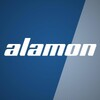

<ul class="info-grid">
  <li>
    
    
      President’s Award for Innovation
      <a href="./professional.md#alamon-inc-kalispell-montana-1">Alamon, Inc.</a>
      Leadership Conference · Jan 2017 · Kalispell, MT
    
  </li>
  <li>
    
    
      Extra Mile Award
      <a href="./professional.md#united-states-department-of-state-rome-italy">U.S. Department of State</a>
      Information Management Office · Sept 2011 · US Embassy, Rome
    
  </li>
  <li>
    
    
      Certificate of Appreciation
      <a href="./professional.md#united-states-department-of-state-rome-italy">U.S. Department of State</a>
      Dedication to Mission · 2010–2012 · US Embassy, Rome
    
  </li>
</ul>

More of the record: <a href="./professional.md">Professional History</a> · <a href="./projects.md">Projects</a> · <a href="./certifications.md">Training and Certifications</a>

