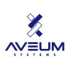

# Projects: High Impact

---

### [Tabulare](https://tabulare.net) – Multi-Platform Contact Assessment & Scoring Platform

**Date**: 2024 – Present  
**Role**: Architect, Lead Developer & Product Owner (Candela Global)

Designed, built, and advanced a full-stack multi-platform application (web, desktop, iOS, Android) from concept through MVP. Owned the complete lifecycle: product vision, system architecture, data modeling, security and compliance posture, CI/CD pipelines, testing strategy, and go-to-market readiness.

- Established declarative, reproducible development and deployment pipelines (Nix, Podman/Quadlets, GitHub Actions) that support consistent environments from local development through production.
- Applied agentic AI tooling as an accelerator for implementation while retaining architectural control and code quality standards.
- Incorporated blockchain-based mechanisms for selected integrity and trust features.
- Designed longitudinal contact scoring and social/network assessment capabilities with associated data models and APIs.
- Prepared custom Terms of Service and Privacy Policy aligned with App Store and Google Play requirements, emphasizing clear liability boundaries and Montana arbitration.

**Technologies**: Rust (Dioxus), PostgreSQL / PostgREST, authentication & billing integrations, containerized pipelines, agentic development workflows, blockchain elements, NixOS.

**Outcome**: Demonstrated end-to-end ownership of a modern product—strategy, architecture, secure implementation, automated delivery, and compliance readiness—as a lean technical leader.

### [Aveum Systems](https://www.aveumsystems.com) - DNA Based ID and Tracking System

---

**Date**: Spring 2024

Supported Aveum Systems, Inc. in formulating their technological road map for developing massively scalable DNA information systems and related technologies. The work focused on identity systems that are hyper-secure, cryptographically rigorous, AI/ML-backed, and resistant to AI-based attacks.

Aveum Systems, Inc. is a Delaware Corporation operating in the US and Europe with pilot programs targeted in Africa and the Kingdom of Saudi Arabia.

### [AlaTrac](https://alatrac.com) - Monetize & Market Ready

---

**Date**: June 2021

AlaTrac is a field service scheduling, asset tracking, and assessment platform used by Alamon field teams to assign, inspect, and capture attributes of industrial and utility assets (telephone poles, energy storage units, cellular towers, and related infrastructure). The solution contributed to division recovery and was positioned for productization as a new revenue source.

Key capabilities include geolocation, role-based field rules, intelligent data routing, image and Bluetooth telemetry capture via an Android Field Collector application, and bandwidth-aware synchronization to the AWS-backed core platform. The system moved beyond MVP into beta with continued hardening for third-party access.

### Transform Application Architecture

---

**Date**: July 2019

Initiated and led the transformation of critical legacy applications from monolithic to microservices and distributed systems. Technologies included Jakarta EE, MicroProfile, PostgreSQL, MongoDB, Lucene/Elasticsearch, GeoTools, and the Hadoop ecosystem (Hive, Spark, etc.), with selective use of cloud vendors.

### Restructure Technology Department

---

**Date**: March 2018

Engaged external subject-matter experts, acquired personnel aligned to green-field development needs, optimized software development processes, and restructured the technology organization so that structural changes remained within financial constraints while supporting strategic growth.

### Federal Business Opportunities Process Development

---

**Date**: March 2017

Designed, implemented, graphically mapped, and trained cross-functional teams on a new process to absorb, screen, evaluate, pursue, and track both direct and subcontract opportunities generated by the U.S. Federal Business Opportunity system (FBO.gov). The process improved communication across departments.

### Geographic Information Processing Cost Reduction

---

**Date**: February 2017

Reduced or avoided significant ArcGIS licensing costs by introducing open-source alternatives (QGIS, GDAL, PostGIS). Trained key users and enabled equivalent functionality for ordinary ESRI-compatible file processing, producing savings equivalent to multiple full-time administrative positions.

### Marketing Effort Support

---

**Date**: April 2016

Supported both direct customer contact and technical aspects of the company’s marketing effort, providing a practical view of account management alongside deep technical work.

### MS-Access Marketing Database

---

**Date**: November 2015

Led team design and implementation of a normalized MS-Access 2013 database for customer contact tracking, bid opportunity follow-up, and revenue projection. Features included austere navigation, automated ICS calendar notifications independent of the user’s email client, and low ongoing cost relative to cloud alternatives.

### Enhanced Project Reporting Site

---

**Date**: August 2015

Built a Java EE (GlassFish, JSF/PrimeFaces, EclipseLink) reporting site that pulled project data from MS-Dynamics/MS-SQL and distributed performance, trending, and chart information to leadership and field managers without requiring additional Dynamics licenses.

### File Management System

---

**Date**: May 2015

Developed a Java EE site that securely distributed payroll information and allowed administrative staff to publish documents by dropping files into a shared Windows folder. The system eliminated ADP payroll service costs, postal costs, and improved document distribution speed.

The roles behind these projects: <a href="./professional.md">Professional History</a> · <a href="./portfolio.md">Portfolio</a> · <a href="./resume_full.md">Résumé Full</a>

